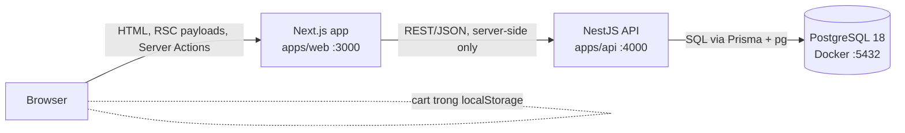
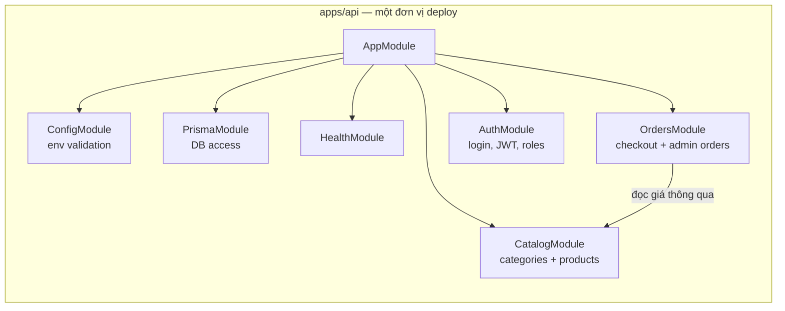

# Kiến trúc

## Trạng thái hiện tại (những gì thực sự đang chạy)

**Chưa có gì chạy cả.** Repository hiện chỉ chứa tài liệu kế hoạch. Phần này được cập nhật cuối mỗi sprint để khớp với thực tế.

## Mục tiêu cho V1 (planned)

Các quy tắc chính cho V1 (xem [ADR-0004](decisions/0004-web-calls-api-server-side.md)):

- **Browser không bao giờ gọi trực tiếp NestJS.** Server Component lấy dữ liệu catalog. Server Action gửi form checkout và form admin. Nhờ vậy không cần CORS, token admin nằm trong cookie httpOnly, và sau này API có thể đặt trong mạng nội bộ.
- **NestJS nắm toàn bộ quy tắc nghiệp vụ.** Tính giá, tổng tiền, validation, chuyển trạng thái và phân quyền đều nằm ở API. Validation ở Next.js chỉ để cải thiện trải nghiệm người dùng.
- **PostgreSQL là source of truth duy nhất.** V1 không có nơi lưu dữ liệu nào khác.

## Bố cục module backend (modular monolith, planned)

Mỗi module nghiệp vụ sở hữu controller, service và DTO của riêng nó. Các module giao tiếp qua những service được export, không bao giờ tuỳ tiện truy cập thẳng vào bảng của module khác. Chính ranh giới này cho phép tách một module ra sau này nếu xuất hiện tín hiệu cụ thể, chẳng hạn nhu cầu scale khác nhau, một team riêng, hoặc nhịp phát hành riêng. Xem [ADR-0001](decisions/0001-modular-monolith-pnpm-monorepo.md).

## Lộ trình phát triển (planned, theo phiên bản)

| Từ | Thành phần thêm vào | Lý do |
|---|---|---|
| V3 | Stripe (test mode) | Thanh toán bằng thẻ; xác nhận bất đồng bộ qua webhook |
| V4 | Container cho web và api | Môi trường tái tạo được, cùng một artifact ở local và production |
| V6 | VPS + Coolify (với proxy & TLS có sẵn) | Truy cập được từ Internet |
| V7 | Nginx (quyết định: chỉ làm lab hay thay một tầng) | Học về proxy, tránh trùng lặp các tầng proxy |
| V8 | Cloudflare R2 | Đưa ảnh ra khỏi app server và DB |
| V9 | Redis | Đọc dữ liệu nóng nhanh hơn; không bao giờ là nguồn dữ liệu chính |
| V10 | Prometheus + Grafana | Thấy được rate/lỗi/độ trễ trước khi thêm các hệ thống bất đồng bộ |
| V12 | RabbitMQ | Đưa các tác vụ phụ chậm hoặc chập chờn (email) ra khỏi luồng request |
| V13 | Bảng outbox + publisher | Không mất event giữa DB commit và lúc publish |
| V14 | Kafka | Event stream có thể replay cho projection/analytics |
| V16 | Kubernetes (lab) | Học điều phối container; việc dùng cho production được quyết định dựa trên bằng chứng |
