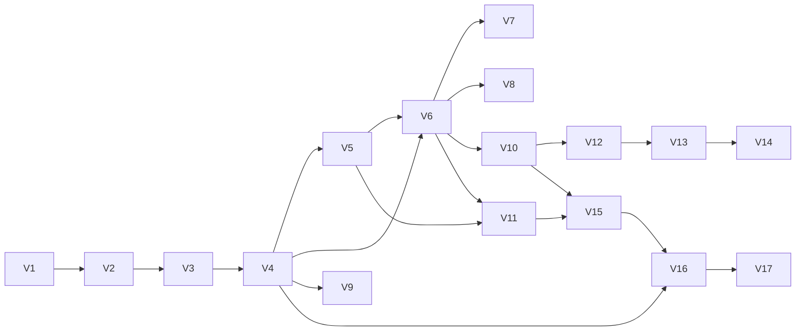

# Roadmap PixelMart

> Chú thích trạng thái: ⬜ Chưa bắt đầu · 🟦 Đã lên kế hoạch (đã có docs) · 🟨 Đang làm · ✅ Hoàn thành (đã kiểm chứng acceptance criteria) · ⏸ Hoãn lại
>
> Một sprint hay phiên bản chỉ được đánh dấu ✅ sau khi acceptance criteria của nó đã được **kiểm chứng bằng cách chạy thật**, không bao giờ dựa trên giả định.

## Chiến lược trong một đoạn

Mỗi phiên bản thêm **một loại vấn đề mới** và công nghệ giải quyết vấn đề đó. Chúng ta không bao giờ đưa vào một công cụ trước khi dự án thực sự gặp cái khó mà nó loại bỏ. Phiên bản nào cũng kết thúc bằng một hệ thống chạy được và demo được. Chúng ta bắt đầu với một **modular monolith** (một NestJS API, một ứng dụng Next.js, một PostgreSQL) vì nó dễ build và debug nhất, và hiện chưa có gì đòi hỏi phải phân tán hệ thống. Hạ tầng chỉ được thêm vào khi xuất hiện nhu cầu cụ thể: khả năng tái tạo môi trường (Docker), an toàn (CI), truy cập được từ bên ngoài (VPS), tốc độ (Redis), khả năng quan sát (metrics), tách rời các thành phần (queue/event), quy mô và điều phối (Kubernetes).

## Thay đổi so với đề xuất ban đầu

| # | Thay đổi | Lý do |
|---|---|---|
| 1 | **CI được chuyển lên trước lần deploy đầu tiên** (giờ là V5, deploy là V6) | Code cần được kiểm tra trước khi deploy. Khi đó Coolify chỉ tự động deploy những commit đã qua CI. |
| 2 | **Observability được chuyển lên trước messaging** (giờ là V10, RabbitMQ là V12) | RabbitMQ, outbox và Kafka rất khó debug nếu không nhìn thấy gì. Các metrics về độ sâu queue, độ trễ của consumer và job thất bại chỉ có ích khi Prometheus và Grafana đã có sẵn. |
| 3 | **Thanh toán online với Stripe (test mode) được thêm vào thành V3** (2026-10-15, theo yêu cầu) | Thanh toán phụ thuộc vào stock reservation và checkout idempotent của V2. Thiếu chúng sẽ phát sinh lỗi "đã trả tiền nhưng hết hàng" và trừ tiền hai lần. Webhook có thể test ở local bằng Stripe CLI, nên thanh toán không cần đợi đến lúc deploy. Thêm nó trước Docker, CI và deployment nghĩa là các phiên bản đó sẽ đóng gói container, test và đưa lên production luồng mua hàng **hoàn chỉnh**. Xem [ADR-0005](decisions/0005-online-payments-stripe.md). Mọi phiên bản phía sau đều dịch lên +1. |

## Thứ tự phiên bản

| Phiên bản | Chủ đề | Công nghệ mới | Phụ thuộc vào | Trạng thái |
|---|---|---|---|---|
| V1 | MVP chạy được (catalog, cart, guest checkout với thanh toán khi nhận hàng, admin tối thiểu) | Next.js, NestJS, PostgreSQL, Prisma, Docker Compose (chỉ Postgres) | — | 🟦 |
| V2 | Tài khoản, phân quyền & quy tắc nghiệp vụ (tồn kho **có reservation**, tìm kiếm, checkout idempotent) | Tìm hiểu sâu Session/JWT, password hashing, stock reservation | V1 | ⬜ |
| V3 | **Thanh toán online (Stripe test mode)** | Stripe Checkout, webhook + xác thực chữ ký, Stripe CLI, refund | V2 | ⬜ |
| V4 | Docker hoá môi trường development & image production | Dockerfile, multi-stage build, network/health check của Compose | V3 | ⬜ |
| V5 | Continuous Integration | GitHub Actions (lint, typecheck, test, build, service Postgres) | V4 | ⬜ |
| V6 | Deploy lên VPS lần đầu | VPS, DNS, TLS, firewall, Coolify (tự động deploy khi `main` xanh), webhook endpoint Stripe cho production | V4, V5 | ⬜ |
| V7 | Reverse proxy | Nginx (lab + quyết định so với proxy có sẵn của Coolify) | V6 | ⬜ |
| V8 | Lưu trữ ảnh | Cloudflare R2 (mặc định), so sánh với Cloudinary | V6 | ⬜ |
| V9 | Caching | Redis (cache-aside, TTL, invalidation, hit/miss) | V4 | ⬜ |
| V10 | Observability | Prometheus, Grafana, structured log, request ID, alert | V6 | ⬜ |
| V11 | Continuous Delivery & lab Jenkins | Pipeline deploy bằng GHA (image registry, rollback), lab Jenkins | V5, V6 | ⬜ |
| V12 | Background job | RabbitMQ (durable queue, ack, retry, DLQ) | V10 | ⬜ |
| V13 | Độ tin cậy khi publish event | Transactional outbox, khử trùng lặp ở consumer | V12 | ⬜ |
| V14 | Event streaming | Apache Kafka (lab trước, sau đó là một analytics projection) | V13 | ⬜ |
| V15 | Gia cố cho production | Secret, diễn tập backup/restore, rate limiting, load test, SLO, đối soát thanh toán | V10, V11 | ⬜ |
| V16 | Kiến thức nền Kubernetes (lab) | kind/minikube, Deployment, Service, Ingress, probe | V4, V15 | ⬜ |
| V17 | Capstone | E2E test, failure testing, ADR tổng kết | tất cả | ⬜ |

## Tiêu chí hoàn thành từng phiên bản (tóm tắt)

| Phiên bản | "Hoàn thành" nghĩa là |
|---|---|
| V1 | Khách guest (không cần tài khoản) có thể duyệt sản phẩm → thêm vào cart → checkout (thanh toán khi nhận hàng) → thấy mã đơn hàng. Admin có thể đăng nhập và quản lý danh mục, sản phẩm, đơn hàng. Backend tính tổng tiền bên trong một DB transaction. Test pass. Hướng dẫn trong README chạy được trên một máy sạch. |
| V2 | Khách hàng có thể đăng ký và đăng nhập. Vai trò (role) được thực thi ở API. Tồn kho không bị âm khi có nhiều checkout đồng thời, và reservation có thể được giữ và giải phóng (V3 cần điều này). Thử lại checkout không tạo ra đơn hàng trùng. |
| V3 | Khách hàng có thể thanh toán bằng thẻ trên trang Checkout do Stripe host (test mode). Đơn hàng chuyển sang `PAID` **chỉ** thông qua một webhook đã xác thực, không bao giờ vì redirect về trang thành công. Webhook trùng lặp hoặc đến sai thứ tự không bị xử lý hai lần. Session bị bỏ dở hoặc hết hạn sẽ giải phóng tồn kho đã giữ. Admin có thể refund một đơn đã thanh toán. Thanh toán khi nhận hàng vẫn hoạt động. |
| V4 | `docker compose up` khởi động web + api + db từ một bản clone sạch. Image production nhỏ gọn và chạy bằng user không phải root. |
| V5 | Mọi PR đều chạy lint, typecheck, unit test + integration test (gồm cả fixture webhook có chữ ký) và build. Có tài liệu về branch protection. |
| V6 | Ứng dụng chạy thật trên một domain qua HTTPS, với webhook endpoint và secret của Stripe riêng cho từng môi trường. Có backup và đã diễn tập restore. |
| V7 | Chúng ta có thể giải thích và demo việc định tuyến qua proxy, forwarded header, debug lỗi 502/504, và lý giải được topology proxy. Raw body của webhook đi qua mà không bị chỉnh sửa. |
| V8 | Admin upload ảnh lên R2 có kiểm tra loại và kích thước file. Thay thế hay xoá ảnh đều dọn sạch các object mồ côi. |
| V9 | Các lượt đọc sản phẩm được cache với hit rate đo được. Thao tác ghi invalidate đúng. Ứng dụng vẫn hoạt động khi Redis ngừng. |
| V10 | Dashboard hiển thị RED metrics (rate, errors, duration) và kết quả thanh toán/webhook. Ít nhất một alert được kích hoạt trong một sự cố mô phỏng. |
| V11 | Merge vào `main` sẽ deploy một image có đánh phiên bản, và rollback là một thao tác một bước đã được ghi lại. Lab Jenkins hoàn tất và đã được so sánh. |
| V12 | Email xác nhận đơn hàng và thanh toán đi qua RabbitMQ với retry và DLQ. Đơn hàng vẫn thành công ngay cả khi gửi email thất bại. |
| V13 | Một lần crash giữa DB commit và publish không làm mất event nào (kể cả `order.paid`). Consumer là idempotent. |
| V14 | Một analytics projection tiêu thụ event đơn hàng từ Kafka và có thể dựng lại bằng cách replay topic. |
| V15 | SLO được định nghĩa và đo lường. Diễn tập restore, baseline tải, runbook rollback và kiểm tra đối soát Stripe↔DB đều được ghi lại kèm bằng chứng. |
| V16 | Toàn bộ stack chạy trong một cluster local, có demo probe, rolling update và rollback. Có quyết định bằng văn bản nên hay không dùng Kubernetes cho production. |
| V17 | ADR kiến trúc tổng kết, kịch bản demo và bộ E2E test đã hoàn tất. |

## Bảng sprint V1

Chi tiết: [`versions/v1/IMPLEMENTATION.md`](versions/v1/IMPLEMENTATION.md) · Acceptance: [`versions/v1/ACCEPTANCE_CRITERIA.md`](versions/v1/ACCEPTANCE_CRITERIA.md)

| Sprint | Mục tiêu | Trạng thái |
|---|---|---|
| V1.1 | Nền tảng workspace: git, pnpm workspace, PostgreSQL trong Docker Compose | ✅ |
| V1.2 | Khung NestJS API: config, health, validation, xử lý lỗi, logging, Swagger | ⬜ |
| V1.3 | Database schema với Prisma: model, migration, constraint, seed | ⬜ |
| V1.4 | API catalog public: danh mục, sản phẩm, pagination | ⬜ |
| V1.5 | Các trang storefront bằng Next.js: danh sách, chi tiết, danh mục; trạng thái loading/rỗng/lỗi | ⬜ |
| V1.6 | Shopping cart (phía client, có thể thay thế) | ⬜ |
| V1.7 | Checkout: tính giá phía server, tạo đơn hàng trong transaction, trang xác nhận | ⬜ |
| V1.8 | Xác thực admin & phân quyền theo vai trò | ⬜ |
| V1.9 | Quản lý catalog cho admin (danh mục, sản phẩm, publish, URL ảnh) | ⬜ |
| V1.10 | Quản lý đơn hàng cho admin (danh sách, chi tiết, chuyển trạng thái) | ⬜ |
| V1.11 | Phát hành V1: chạy toàn bộ test, README từ bản clone sạch, rà soát acceptance, gắn tag `v1.0.0` | ⬜ |

## Sprint log

_Mỗi sprint hoàn thành sẽ có một bản tóm tắt ở đây: đã triển khai gì, đã học gì, đã test gì, còn dang dở gì, tech debt, docs đã cập nhật, sprint tiếp theo._

### V1.1 — Workspace foundations (2026-10-16) ✅
- **Đã triển khai:** git repo, pnpm workspace, `docker-compose.yml` với PostgreSQL 18 (named volume, healthcheck, port lấy từ env), init script tạo `pixelmart_test`, các script `db:up/down/logs/psql`, `.editorconfig`, `.node-version`.
- **Đã học:** `environment` trong Compose là map *hoặc* list `KEY=value`, không được trộn; đổi `POSTGRES_USER` sau khi volume đã khởi tạo không có tác dụng, phải `down -v`; `db:psql` không nên gõ cứng user.
- **Đã test:** AC-1.1-01…07 đều được kiểm chứng bằng cách chạy thật (bằng chứng trong ACCEPTANCE_CRITERIA).
- **Docs đã cập nhật:** `README.md` (Bắt đầu đến V1.1), `docs/DEVELOPMENT.md` (bảng lệnh hằng ngày, reset database, lưu ý), ACCEPTANCE_CRITERIA.
- **Còn dang dở:** bài tập troubleshooting §8 và câu hỏi ôn tập §9 chưa làm.
- **Tech debt:** `pnpm-workspace.yaml` có `packages/*` dù chưa cần; IMPLEMENTATION ghi `pnpm@12.4.2` trong khi thực tế là 12.11.2.
- **Sprint tiếp theo:** V1.2 — Khung NestJS API.
