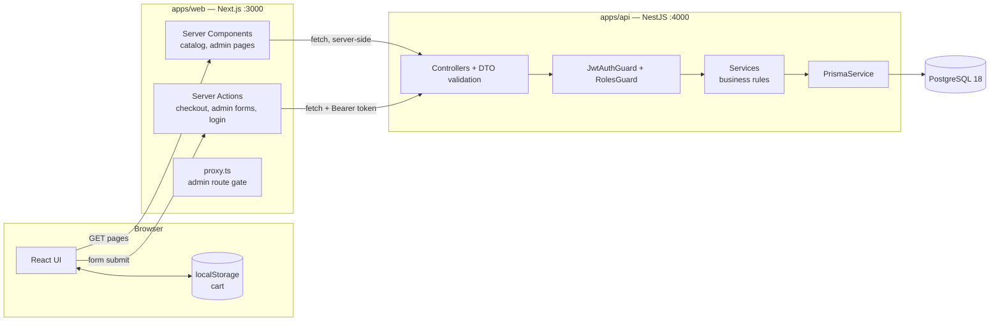
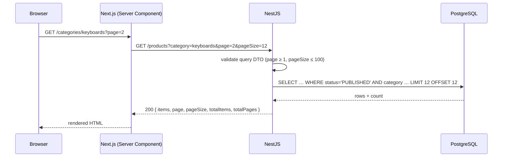
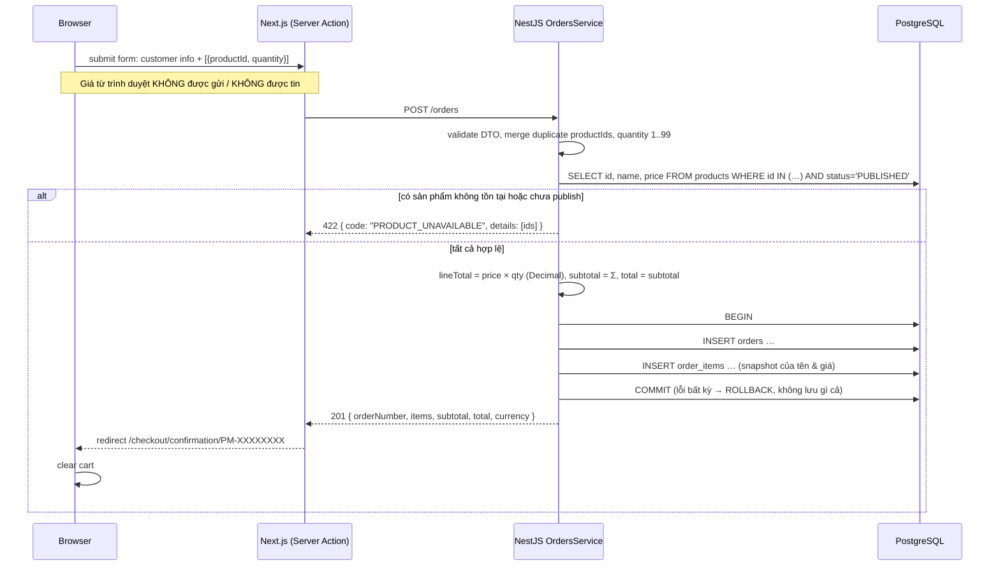

# Kiến trúc V1

## Các thành phần



## Luồng request: duyệt một danh mục



## Luồng request: checkout (luồng quan trọng nhất của V1)



**Vì sao transaction quan trọng:** nếu không có nó, một sự cố xảy ra sau khi insert `orders` nhưng trước `order_items` sẽ để lại một đơn hàng không có dòng nào. Có transaction, database đảm bảo hoặc tất cả, hoặc không gì cả.

**Lỗ hổng đã biết của V1:** nếu giá thay đổi giữa lúc xem trang và lúc checkout, khách hàng trả theo giá mới được hiển thị trên trang xác nhận. V2 thêm bước "giá đã thay đổi, vui lòng kiểm tra lại".

## Các API endpoint (V1, dự kiến)

Path không có prefix. Các endpoint của admin nằm dưới `/admin` để ranh giới của guard rõ ràng.

| Method | Path | Auth | Mục đích |
|---|---|---|---|
| GET | `/health` | public | Liveness + kết nối tới DB |
| GET | `/categories` | public | Tất cả danh mục |
| GET | `/categories/:slug` | public | Một danh mục |
| GET | `/products?page&pageSize&category` | public | Sản phẩm đã publish, có pagination |
| GET | `/products/:slug` | public | Một sản phẩm đã publish (404 nếu là draft) |
| POST | `/orders` | public | Guest checkout |
| GET | `/orders/:orderNumber/summary` | public | Dữ liệu cho trang xác nhận. **Không có PII** (không tên/email/số điện thoại/địa chỉ). |
| POST | `/auth/login` | public | Trả về JWT khi thông tin đăng nhập hợp lệ |
| GET | `/auth/me` | admin | Người dùng hiện tại |
| GET, POST | `/admin/categories` | admin | Danh sách / tạo mới |
| PATCH, DELETE | `/admin/categories/:id` | admin | Cập nhật / xoá (409 nếu còn sản phẩm) |
| GET, POST | `/admin/products` | admin | Danh sách mọi trạng thái / tạo mới |
| GET, PATCH, DELETE | `/admin/products/:id` | admin | Đọc / cập nhật (kể cả trạng thái) / xoá |
| GET | `/admin/orders?page&pageSize&status` | admin | Danh sách đơn hàng có pagination |
| GET | `/admin/orders/:id` | admin | Toàn bộ đơn hàng, kể cả dữ liệu khách hàng |
| PATCH | `/admin/orders/:id/status` | admin | Chuyển trạng thái (409 nếu không hợp lệ) |

## Quy ước (contracts)

### Response lỗi (mọi mã khác 2xx)

```json
{
  "statusCode": 422,
  "code": "PRODUCT_UNAVAILABLE",
  "message": "One or more products are not available",
  "details": [{ "productId": "0199…" }],
  "requestId": "b3c1…",
  "path": "/orders",
  "timestamp": "2026-10-15T18:00:00.000Z"
}
```

- `code` ổn định và máy đọc được (UI dựa vào nó để rẽ nhánh xử lý). `message` dành cho con người.
- Lỗi validation: `400`, `code: "VALIDATION_FAILED"`, `details: [{ field, constraints }]`.
- Lỗi không xác định: `500`, `code: "INTERNAL_ERROR"`, thông báo chung chung. Stack trace **chỉ ghi vào log**, không bao giờ đưa vào response.
- Các lỗi Prisma đã biết được ánh xạ: vi phạm unique → `409 CONFLICT`, FK restrict → `409`, không tìm thấy bản ghi → `404`.

### Pagination

Request: `?page=1&pageSize=20` (mặc định 1/20, `pageSize` tối đa 100).
Response: `{ "items": [...], "page": 1, "pageSize": 20, "totalItems": 137, "totalPages": 7 }`.

Offset pagination đơn giản và hỗ trợ "nhảy tới trang 5". Hạn chế của nó là `OFFSET 100000` chạy chậm, và các dòng bị xô lệch khi có item mới được insert. Cursor pagination được bàn ở V2 và sẽ dùng nếu cần.

### Tiền

Chuỗi có hai chữ số thập phân (`"19.99"`). Xem [ADR-0003](../../decisions/0003-money-representation.md).

## Chiến lược rendering (Next.js)

| Khu vực | Chiến lược | Lý do |
|---|---|---|
| Danh sách / chi tiết sản phẩm / danh mục | Server Components, dynamic (mới cho mỗi request) | Luôn đúng. Cache sẽ được thêm vào một cách có chủ đích sau này và được đo lường (V9). |
| Cart, nút điều chỉnh số lượng | Client Components | Cần state của trình duyệt và tương tác. |
| Form checkout | Form phía client + Server Action | Progressive enhancement. Gọi API từ phía server. |
| Các trang admin | Server Components + Server Actions, được chặn bởi `proxy.ts` **và** guard của API | `proxy.ts` chỉ phục vụ UX (chuyển hướng về login). **Guard của API mới là ranh giới bảo mật thật sự.** |
